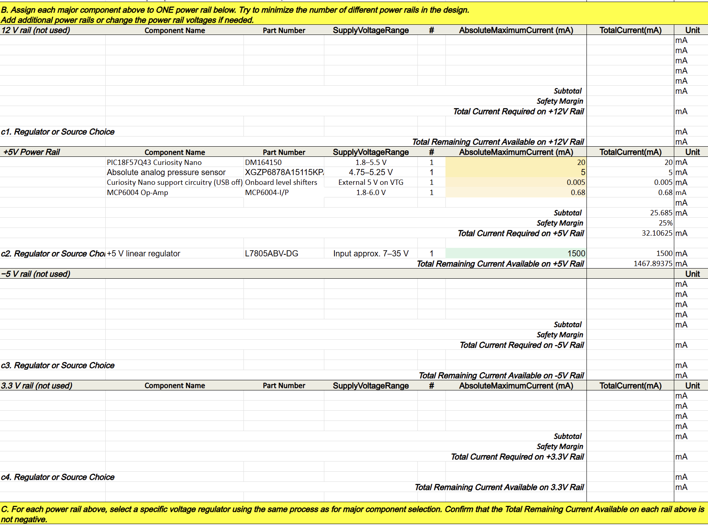
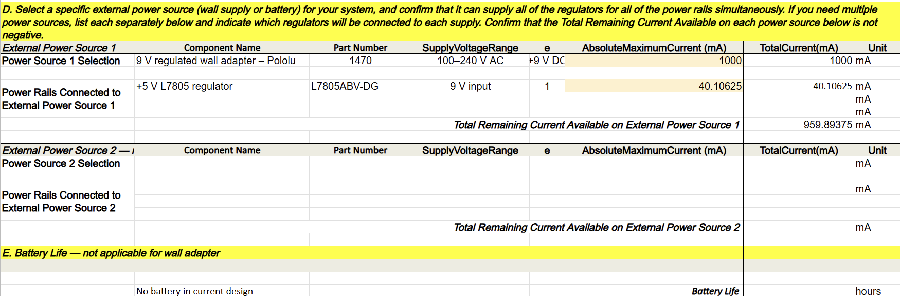

## Overview

## Overview

The purpose of this power budget is to determine the electrical power requirements of my pressure-sensing subsystem and ensure that the selected voltage regulator and external power supply can safely operate all components.

The subsystem uses a Pololu 1470 power supply to provide 9V DC to an L7805ABV-DG voltage regulator, which converts the voltage to 5V. This regulated 5V supply powers the PIC18F57Q43 Curiosity Nano, CFSensor XGZP6878A15115KPA pressure sensor, and MCP6004 operational amplifier.

The MCP6004 provides analog signal conditioning, while an RC low-pass filter reduces high-frequency noise before the pressure measurement is processed by the microcontroller.

The total estimated current consumption of the major components was calculated, and a 25% safety margin was added to account for potential variations in power consumption.

## Power Budget

The power budget was divided into four sections:

* **Section A:** Maximum current consumption of major components.
* **Section B:** Power rail assignments and safety margin.
* **Section C:** Voltage regulator selection and available current.
* **Section D:** External power supply selection and available current.

The system operates using a single regulated 5V power rail.

### Power Budget Summary

| Component                        | Estimated Current |
| -------------------------------- | ----------------- |
| PIC18F57Q43 Curiosity Nano       | 20 mA             |
| CFSensor XGZP6878A15115KPA       | 5 mA              |
| MCP6004 Operational Amplifier    | 0.68 mA           |
| Curiosity Nano Support Circuitry | 0.005 mA          |
| **Total Current**                | **25.685 mA**     |
| 25% Safety Margin                | 6.421 mA          |
| **Total Required Current**       | **32.106 mA**     |

The PIC and pressure sensor current values are provisional estimates that require verification against manufacturer specifications or physical testing. The MCP6004 current estimate represents its maximum quiescent current allowance rather than its total consumption under every possible load.

The selected L7805ABV-DG voltage regulator has a rated output current capacity of 1,500 mA, which exceeds the estimated subsystem requirement of 32.106 mA. The Pololu 1470 power supply provides 9V DC at up to 1,000 mA, offering sufficient nominal capacity for the estimated load.

Based on these calculations, the selected power components provide adequate current capacity for the pressure-sensing subsystem, subject to verification of actual component loads and regulator thermal performance.

### Power Budget Calculations

## Conclusions

## Conclusion

The power budget indicates that the selected power supply and voltage regulator have sufficient current capacity to operate the pressure-sensing subsystem, including the PIC18F57Q43 microcontroller, CFSensor XGZP6878A15115KPA pressure sensor, and MCP6004 operational amplifier.

The estimated total current consumption is **25.685 mA**, with a total required current of **32.106 mA** after including the 25% safety margin.

The L7805ABV-DG voltage regulator is rated to supply up to **1500 mA**, which exceeds the subsystem's estimated requirements.

The Pololu 1470 power supply provides 9V at a maximum of 1000 mA. Including a provisional 8 mA allowance for regulator current consumption, the estimated input current requirement is **40.106 mA**. This leaves approximately **959.894 mA** of available current capacity.

These calculations suggest that the selected components are suitable for the subsystem's power requirements. However, the maximum current consumption of the microcontroller, pressure sensor, and operational amplifier should be verified before the final design review. The voltage regulator's thermal performance should also be evaluated.

## Resources

The completed power budget is available in the following formats:

- [Power Budget Excel Spreadsheet](Power_Budget_Pressure_Sensor.xlsx)
