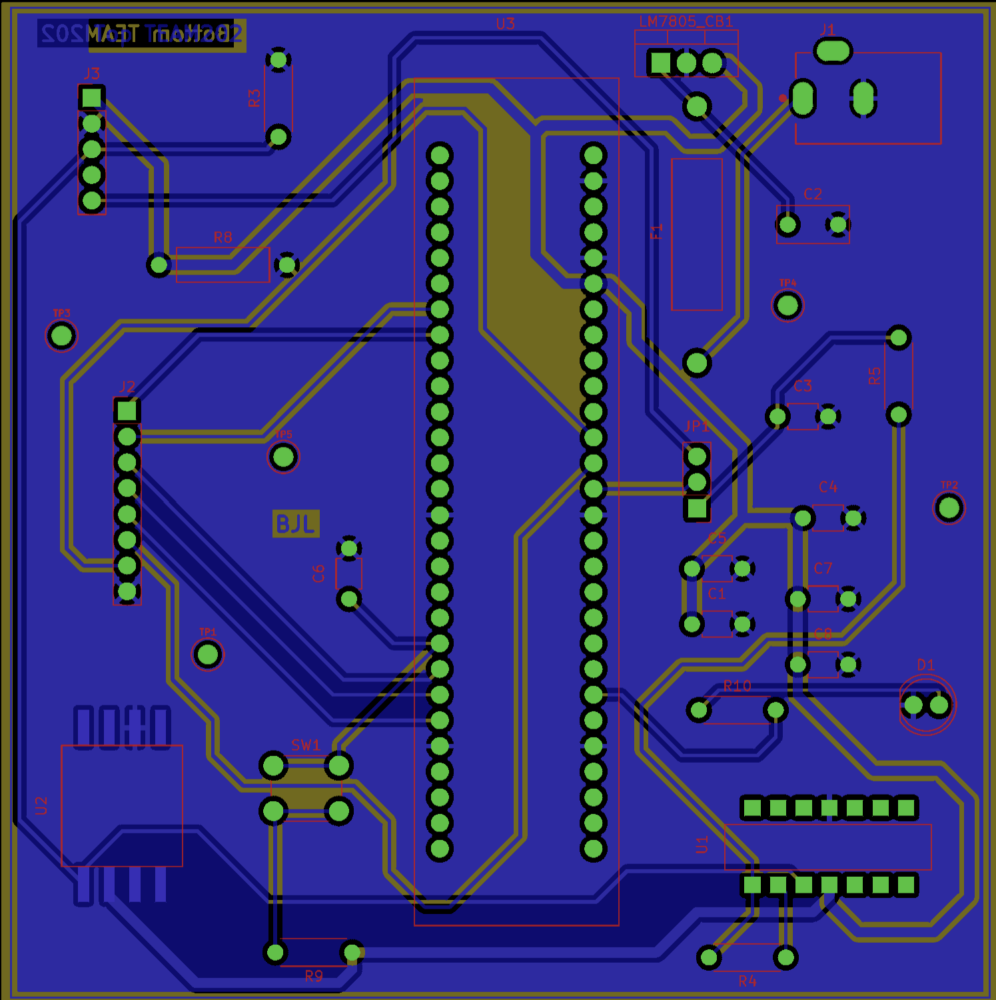
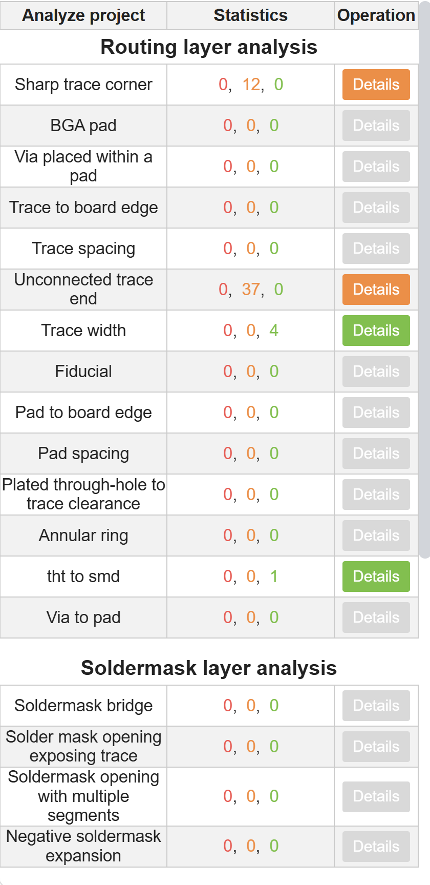
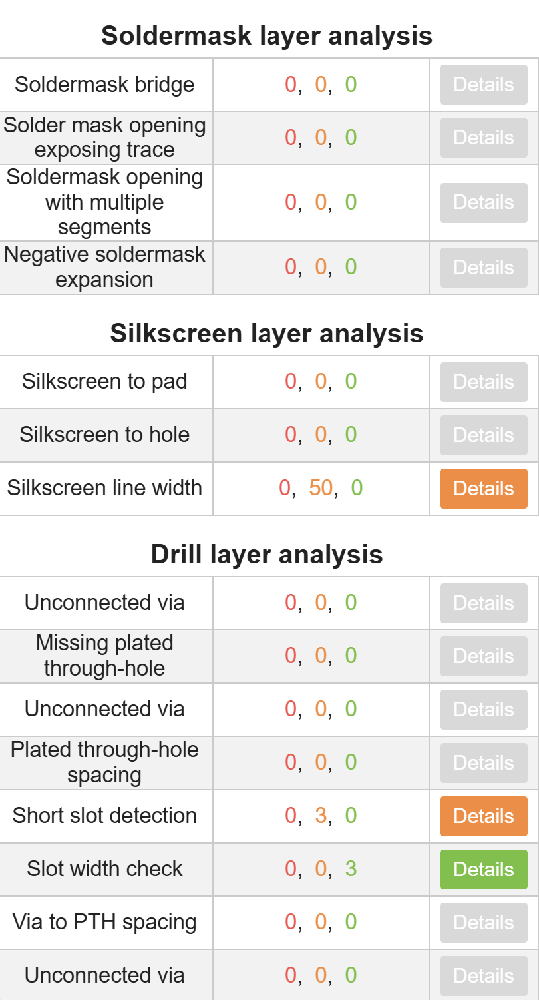
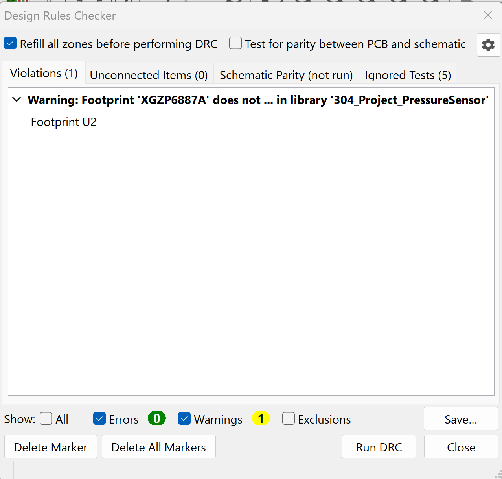

# PCB Design

## Pressure Sensor PCB

This page documents my EGR 304 pressure sensor PCB design.

## PCB Layout

### Front Copper Layer

[View Front PCB Layout (PDF)](PCB-Front.pdf)

### Back Copper Layer

[View Back PCB Layout (PDF)](PCB-Back.pdf)

## PCB Manufacturing and Verification

The following files contain the completed PCB design,
manufacturing outputs, and verification documentation.

### Manufacturing Verification

#### JLCPCB Design for Manufacturing (DFM)

The following images document the PCB manufacturing verification performed using JLCPCB's DFM analysis tool.

**PCB Overview**

**DFM Analysis 1**

**DFM Analysis 2**

[View Complete JLCPCB DFM Report (PDF)](DFM%20analysis%20report_JLCDFM_GERBER.zip.pdf)

#### KiCad Design Rules Check (DRC)

The following image shows the results of the KiCad Design Rules Checker.

[View KiCad DRC Report (PDF)](Pressure-Sensor_DRC.pdf)
### Manufacturing Files
- [Gerber and Drill Files](GERBER.zip)

### Complete KiCad Project
- [Download Complete KiCad Project](EGR304_PressureSensor_Project.zip)
