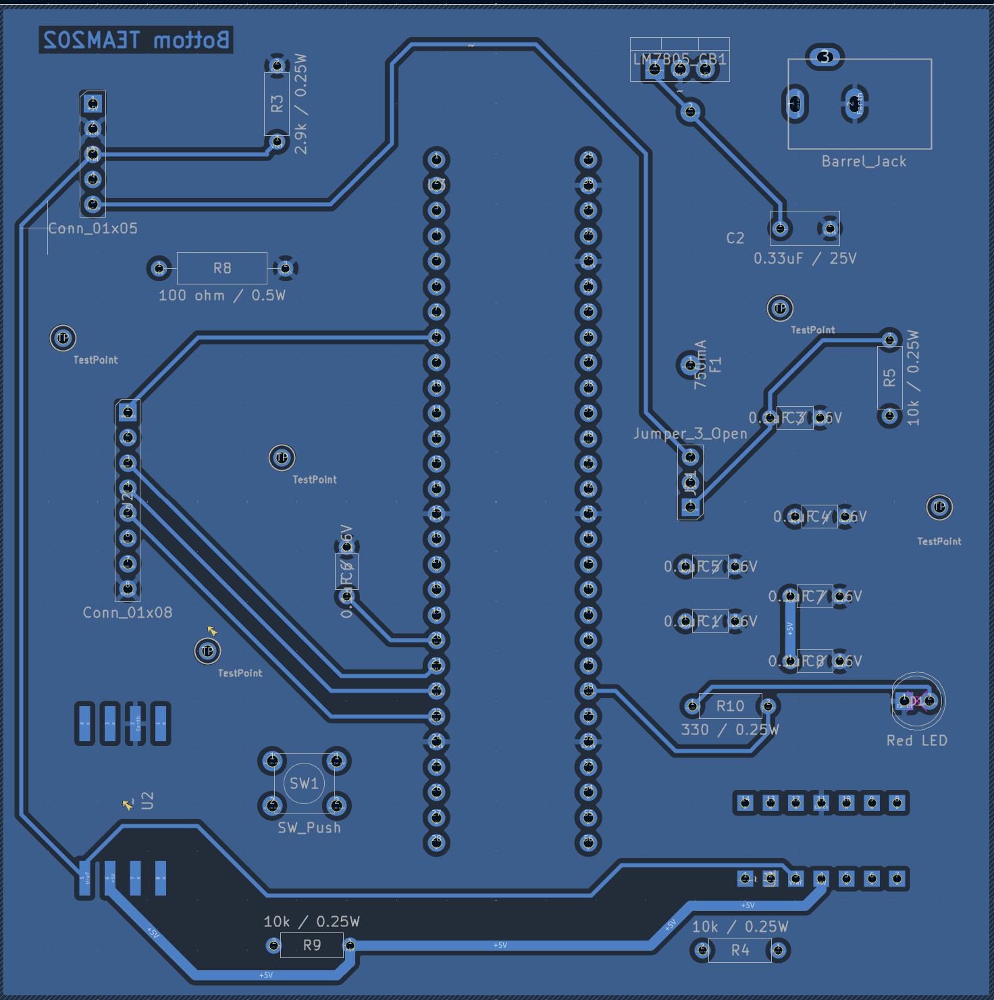

# PCB Design

## Pressure Sensor PCB

This page documents my EGR 304 pressure sensor PCB design.

## PCB Layout

### Front Copper Layer

[View Front PCB Layout (PDF)](PCB-Front.pdf)

### Back Copper Layer

[View Back PCB Layout (PDF)](PCB-Back.pdf)

### Front Copper Layer
[View Front PCB Layout (PDF)](PCB-Front.pdf)
### Back Copper Layer
[View Back PCB Layout (PDF)](PCB-Back.pdf)

## PCB Manufacturing and Verification

The following files contain the completed PCB design,
manufacturing outputs, and verification documentation.

### Manufacturing Verification
- [JLCPCB DFM Analysis Report](DFM%20analysis%20report_JLCDFM_GERBER.zip.pdf)
- [KiCad Design Rules Check (DRC) Report](Pressure-Sensor_DRC.pdf)
### Manufacturing Files
- [Gerber and Drill Files](GERBER.zip)

### Complete KiCad Project
- [Download Complete KiCad Project](EGR304_PressureSensor_Project.zip)
